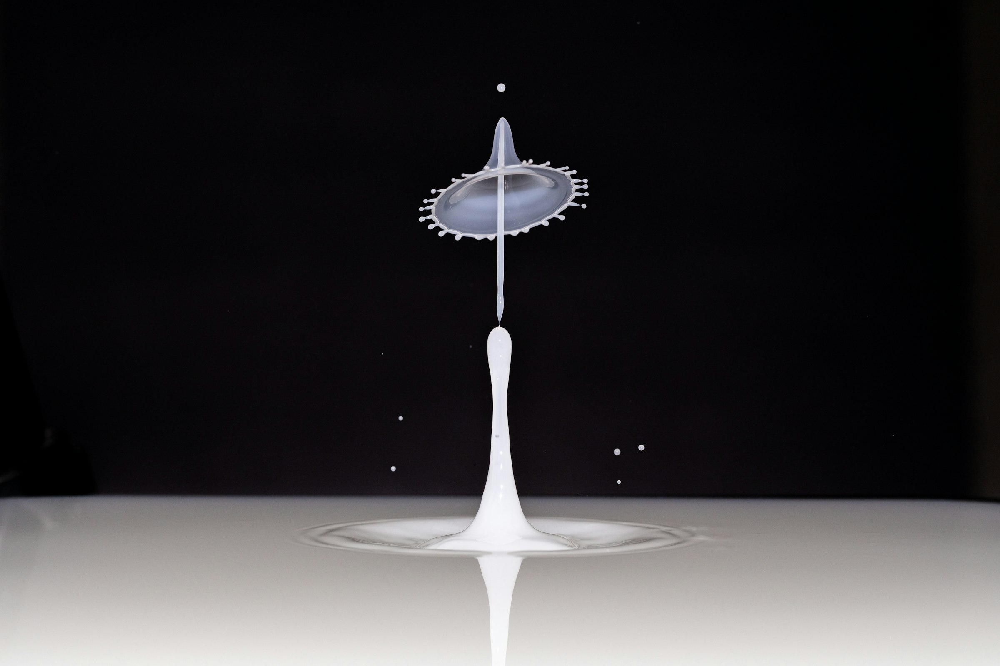

# MATH INTELLECT — FILM 03
## Master director's script and photographic casting ledger
**Date:** 13 October 2026  
**Authority:** Active creative pre-production master. Refines Film 01 (creative premise) and Film 02 (cue sheet).  
**Strict current phase:** NO marketing frontend implementation or JSX/CSS changes. Story, casting, photo provenance, downloadable source-media assets, responsive crop approval.  
**Working branch:** main only.  
**Production identity:** ONE CONDITION / MANY OUTCOMES.

> **Production truth:** The live website remains its current marketing implementation. The cinematic media in this document is *staged but unused*. No animation, hero replacement, new routes, or model atlas implementation has been falsely marked complete.

---

# 1. Director's final dramatic thesis

**Not a set of mathematical topics. Not a series of decorated cards. Not a physics-simulator landing page.**

This is the story of a single controlled question: **What changes when one condition changes?**

The film moves between three representational worlds without losing the same user-created scenario:

1. **The physical world:** a deliberately cast series of real photographs from a controlled high-speed liquid-impact experiment. The images are an editorial physical metaphor for uncertain outcomes — never a claim that Math Intellect numerically simulates that fluid.
2. **The computational world:** actual seeded Monte Carlo public demonstration using μ=0.05, σ=0.35, steps=50, paths=24, seed=42. The trace is the product-native protagonist. It only moves in ways consistent with actual computed trajectories, and every real parameter is stated truthfully.
3. **The human world:** photographic moments of interaction, choice and engineered measurement that widen the experience to the other genuine model categories. Each new image is a new kind of question, not random infrastructure.

**Key transition:** first, visitors see an event; then they see its *conditions*; then they see what changing conditions does to a mathematical model. The math is not claimed to be the formula governing the photographed droplet.

**What persists:** the scenario's seed, baseline parameters, trace source coordinate and the physical photographic cast. The path may change shape on intervention but its origin remains anchored.

**Emotional arc:** arresting wonder → inspection → multiplicity → understanding → personal agency → clear consequence → expansive possibility → reproducibility → invitation.

**Audience action:** move naturally from visual curiosity into a real, accurately described mathematical workbench.

## Copy hierarchy
Opening: **"What if one thing changed?"**  
Argument: **"A result begins long before it happens."**  
Condition: **"Every outcome has its conditions."**  
Variation: **"The possibilities don't take one path."**  
Agency: **"Change the condition."**  
Consequence: **"Now see what moved."**  
Breadth: **"Different questions. Different mathematics."**  
Return: **"Run it again. See what holds."**  
Finale: **"Make the unknown something you can work with."**

The lines are final directorial roles; exact line-break art direction is conditioned on real stills. Avoid visitor-facing "Movement 01", numbered acts, long eyebrow labels, jargon-first hero copy, fake performance claims.

---

# 2. Image casting — provenance FIRST

The current repository's original 22-photo series is dominated by urban crossings, rail yards, shipping, rivers, birds, and desert roads. User rejected this visual world. **Do not pull it into the new protagonist journey by default.**

## Actual source-media assets securely staged in GitHub on main

All four are derived photo deliveries from images.unsplash.com, *not the untouched camera-original RAW files*, and all source pages display **Free to use under the Unsplash License**. Exact producer, source page, derivative request and path below.

### MI-CIN-01 / Origin / Pete Godfrey
- **Committed file:** \`frontend/public/media/math-intellect/cinematic/source/mi-film-impact-origin.jpg\`
- **Source:** https://unsplash.com/photos/milk-splash-frozen-in-time-against-black-background-6ieRRBACAqM
- **Creator:** Pete Godfrey (@octopus_photo)
- **Source description:** "Milk splash frozen in time against black background."
- **Photographic subject:** solitary rising white impact column and crown against a nearly black experimental backdrop.
- **Cinematic function:** protagonist world entry, freeze-frame crop, evidence plate; master photo returned in Shot 13 and final footer transition.
- **Retrieved derivative:** 2400px maximum width, JPEG, q=76, 174451 bytes, staged as a binary Git blob.
- **Art direction:** dark uninterrupted negative space enables imposing, considered typography; the centered column provides a predictable pan/zoom anchor. Preserve source crop and avoid placing a headline over the white liquid crown.
- **Mobile test:** center-crop must keep column and crown visible, with title high or left clear of subject.
- **Status:** SOURCE SECURED / NOT YET CROPPED, OPTIMIZED, OR USED IN JSX.

### MI-CIN-02 / Aftermath / Pete Godfrey
- **Committed file:** \`frontend/public/media/math-intellect/cinematic/source/mi-film-impact-aftermath.jpg\`
- **Source:** https://unsplash.com/photos/milk-splash-with-droplets-against-black-background-UAjcZ1qBzE0
- **Creator:** Pete Godfrey (@octopus_photo)
- **Source description:** "Milk splash with droplets against black background."
- **Photographic subject:** second genuine milk-impact geometry from the same studio-photography family.
- **Cinematic function:** variation still, causal contrast after intervention and reprise. No claim that this photograph represents the computed model output.
- **Retrieved derivative:** 1800px maximum width, JPEG q=72, 98799 bytes, staged as a binary Git blob.
- **Status:** SOURCE SECURED / NOT YET CROPPED, OPTIMIZED, OR USED IN JSX.

### MI-CIN-03 / Material variation / Pete Godfrey
- **Committed file:** \`frontend/public/media/math-intellect/cinematic/source/mi-film-impact-variation-mono.jpg\`
- **Source:** https://unsplash.com/photos/water-droplet-collision-creating-a-crown-splash-6nk-Shl0fsw
- **Creator:** Pete Godfrey (@octopus_photo)
- **Source description:** "Water droplet collision creating a crown splash."
- **Photographic subject:** a third still from the same liquid collision experiment series.
- **Cinematic function:** a third photographic beat in the first major transformation; use for visual variation with careful matched crop. Do not imply the photos are sequential frames of one actual event.
- **Retrieved derivative:** 1700px maximum width, JPEG q=70, grayscale color request, 96175 bytes.
- **Status:** SOURCE SECURED / NOT YET CROPPED, OPTIMIZED, OR USED IN JSX.

### MI-CIN-04 / Human interaction / Green Liu
- **Committed file:** \`frontend/public/media/math-intellect/cinematic/source/mi-film-human-interaction.jpg\`
- **Source:** https://unsplash.com/photos/a-group-of-people-standing-next-to-each-other-OwgaIM4e9TY
- **Creator:** Green Liu
- **Source description:** silhouetted people conversing against a sky at sunset.
- **Cinematic function:** *potential* human interaction lens in the Models gallery. Represents strategic participants, not an example dataset or Math Intellect users.
- **Retrieved derivative:** 1500px maximum width, JPEG q=69, 115086 bytes.
- **Status:** SOURCE SECURED / CREATIVE APPROVAL PENDING because sunset palette/crop must be tested alongside monochrome protagonist frames. Do not hard-lock it as Game Theory or Conflict before comparing the five model images as one gallery.

## Candidate-only image searches — NOT downloaded and NOT licensed/locked as deployed assets

| Lens or role | Candidate / creator | Canonical source | Current state | Design risk |
|---|---|---|---|---|
| Game Theory | Ahmet Yüksek, two people in conversation | https://unsplash.com/photos/two-people-chat-at-the-beach-OYauKifyCWI | Source page checked; **candidate only** | Calm beach may communicate conversation but not consequential strategic choices |
| Market | Jakub Żerdzicki, actual trader with monitor | https://unsplash.com/photos/trader-analyzing-stock-market-charts-on-multiple-screens-j_hho1mE47s | Source page checked, partial byte fetch only; **NOT delivered** | Generic neon trading workstation, may conflict with visual world; no fabricated chart interpretation |
| Conflict | Max Titov, black-and-white concert crowd | https://unsplash.com/photos/a-black-and-white-photo-of-a-crowd-at-a-concert-KlaKVJvRcQM | Source page checked; **candidate only** | Too dark in the tested thumbnail to carry a 55–70vw primary photographic panel |
| Custom | Hans Westbeek, caliper measurement | https://unsplash.com/photos/hands-using-a-digital-caliper-to-measure-metal-part-_luiFaaZU6k | Source checked, partial byte fetch only; **NOT delivered** | Traditional workshop aesthetic too ordinary for a premium cinematic finale; useful more as secondary material |
| Method | Doug Baney, physical oscilloscope | https://unsplash.com/photos/black-and-white-audio-mixer-daADC54moaU | Source checked, partial byte fetch only; **NOT delivered** | Screen glyphs might be misread as a Math Intellect UI |
| Alternative method material | Frantisek Duris, black-and-white industrial machine | https://unsplash.com/photos/a-black-and-white-photo-of-a-machine-kUQ6ohn9NRQ | Source checked, partial byte fetch only; **NOT delivered** | Photographically stronger material detail but less model-specific |
| Optical interlude | David Clode, physical prism experiment | https://unsplash.com/photos/a-picture-of-a-colorful-object-with-a-black-background-nGZxiTwNGn8 | Source page checked; **candidate only** | Spectral rainbow collides with restrained interface chroma |
| Ripply closeout | Nithin Joseph, water ripple macro | https://unsplash.com/photos/water-drop-creating-ripples-on-the-surface-lMuSFC0vPV4 | Source page checked; **candidate only** | Different photographer, unrelated event; weaker continuity than Pete Godfrey matched photographic series |

**Do not treat any row in this candidate table as a finished asset.** No Unsplash+ entitlement has been verified, and no Unsplash+ licensed-only image has been taken from a locked download flow. The four committed images are from photos whose public pages explicitly identify them as free under the standard Unsplash License.

## Media-grade gate
- Every principal image 8/10 standalone visual quality after real 1440×900 layout placement, and every gallery panel 8/10 at its delivered 55–70vw size. A photo that merely has a technically relevant subject does not pass.
- At least 2200px delivery for 1440px hero and crop-safe source; separate responsive AVIF/WebP derivatives and a portrait art-directed alternative after casting lock.
- Identify frame orientation, pixel dimensions, focal point, license, credit, download URI, rendered role, dominant colors, high-density source and mobile crop.
- Whole-gallery adjacency must read as one campaign. A bright random stock photograph beside two monochrome fluid stills fails even if each image individually looks good.
- No remote unsplash hotlink used as the final public JSX source.
- No fake product screenshots or misleading AI-created photos.
- No photo downloaded here represents an actual simulation output or customer.

---

# 3. MASTER SHOT/BLOCK MAP: 14 CINEMATIC SHOTS

A picture is a continuous stage actor, not an image inside a card. Five sections hold fourteen film shots with change expressed as changes of crop/ownership, not endless jump-cuts.

| Shot | Audience experience | Primary media | Protagonist signal | Cinematic motion | Stage-to-stage transition |
|---|---|---|---|---|---|
| 01 Threshold | What if one thing changed? | MI-CIN-01 hero | Initial unresolved question | Large photo, slow cinematic scale | photo detail slides into negative space |
| 02 Freeze | One event, multiple readings | MI-CIN-01 second crop | Scenario source mark born | Photo shrinks into off-center 4:5 experimental plate | plate stays on screen |
| 03 Conditions | Every outcome has its conditions | MI-CIN-01 or 03 | σ .35, μ .05, seed 42 physically registered | One matte measurement band enters | registered point becomes plot origin |
| 04 Branch | The possible worlds | MI-CIN-03 periphery | 24 real seeded paths | Rooted paths spread unevenly | same trace persists |
| 05 Wide sweep | Spatial field expands | MI-CIN-01 narrow crop + real paths | Same mathematical origin | near/far photo parallax + restrained lateral sweep | late-arriving sample paths settle |
| 06 Quiet | The spread is measurable | MI-CIN-01 residue | real sample variance | almost still, precise typesetting | control enters without cut |
| 07 Intervention | Visitor adjusts a condition | MI-CIN-02 takes partial ownership | native σ range updates actual result | incoming crop anticipates baseline comparison | event and data differ honestly |
| 08 Consequence | Before and after | MI-CIN-01/02 as *analogy*, paired actual data | fixed seed, changed σ | matched axes, baseline stays | changed value becomes dominant |
| 09 Read | Know what moved | MI-CIN-01 slim strip | actual variance delta | low-motion hold | first model image arrives before data exits |
| 10 Horizontal passage | Other questions are visible | five gallery photos, only one sourced candidate | model family identity | actual pinned horizontal gallery / widths measured | next visible frame previews traversal |
| 11 Selection | Select a mathematical lens | selected model photo | selected engine | real source rect captured for route FLIP | image transferred to /models |
| 12 Replay | Same starting state, same outcome | MI-CIN-03 → MI-CIN-01 | exact seed+inputs | coherent rewind of true path | first photo expands again |
| 13 Return | Make the unknown workable | MI-CIN-01 revisit | full scenario memory | restrained crop change and text | kinetic type leads to closing identity |
| 14 Monument | MATH INTELLECT | MI-CIN-01 subtle residue, subject to crop test | core product identity | closing huge wordmark and utility reveal | static footer always works |

**Crucial copy/math distinction:** A milk-drop photograph is editorial analogy. Monte Carlo path movement is calculated from the *real* deterministic model. They coexist but never claim equivalence. No physics claims, no screenshots presented as evidence, and no fake verification hash.

---

# 4. THE DIRECTOR'S CUT — FRAME PHYSICS

## Film language
- **Camera** = actual DOM image crop/window and subtle parallax, not a fabricated Three.js mesh.
- **Dolly** = scale/perspective changes of photographic material with overscan, never continuously scaling every section.
- **Match cut** = same physical subject/focal feature conserved across successive image states.
- **J cut / anticipation** = incoming model category image visible before outgoing illustration resolves.
- **Reaction shot** = changed computed distribution and metric (not a random splash image changing magically).
- **Dissolve** = limited, short and justified when one form truly becomes another.
- **Breath** = still and readable hold before asking user to interact.
- **Finale** = the source photograph returning as an intentional identity backdrop, not isolated footer utility.

### Photo handoff choreography
- On Scroll progress enter photograph: 0–12% full hero + title, image movement minimal.
- 12–34% inner-image crop starts counter-moving; evidence plate takes up 35–45% at varied position.
- 34–52% original frame remains behind; second legitimate crop enters with 5–12% anticipation.
- 52–78% exact experimental state annotation and one source node become legible.
- 78–100% photo recedes to a peripheral matte field while seeded SVG traces begin; first trace aligns to *real* anchor rect in the layout.
These are initial motion windows, not proof of tested runtime.

### Branch choreography
- A single numerical trajectory is readable before its 23 companions appear.
- The camera moves across branches rather than panning over a static HTML plot.
- By the last 20% all paths have resolved; a short proof statement and actual variance can be read.
- Only one axis/legend family at a time. Technical exploration moves into /workbench or /method.

### Intervention choreography
- The range input is actual HTML control, state ownership lies with the user.
- Slider changes just σ; baseline μ, seed, paths, and steps remain anchored unless user changes them in Workbench.
- A before/after comparison uses actual recalculated data on the same axes.
- Scroll never resets the user's chosen value.
- Printed numerical evidence is always from the helper, not creative copy.

### Gallery choreography
- One horizontal-only desktop spectacle, fixed to the model atlas, not four different cloned horizontal scrollers.
- The next photograph is visible before scrolling begins to signal continuation.
- Each model has a unique silhouette/image shape, 5–12% next peek, 20–40% overlap during passage and a reading settle.
- Images do not spin simply because the spinner reference looks impressive. Image-spinner motion is authorized only as a genuine selected-model navigation interaction if still composition improves.
- Engine names are real, links real, interactions keyboard accessible; mobile becomes vertical art-directed gallery.

### Finale choreography
- The closing scene reprises MI-CIN-01 and progressively gives ownership to gigantic "MATH INTELLECT".
- The footer is already rewritten in the existing app, but its photo handoff is intentionally NOT implemented before final source-media crop tests.
- No compulsory scroll loader, video gate or route delay.

---

# 5. SECONDARY ROUTE EXPERIENCE AND CASTING

## Models — a cinema you can navigate
- The model images are *most important missing photo family*: five differently composed, equally art-directed subjects.
- Visual organization: first frame dominant, next 5–12% peeking, route transition to selected photo through measured rectangle. 
- Each model's data/equation/limits available without animation. Do not reuse the same image for all five merely to fill the layout.
- Current MI-CIN-04 may suit a **human interaction context**, but is only provisional. Whether it is strategic or conflict subject is evaluated in the five-image gallery as a group.
- Gallery not code-ready until 5/5 principals physically staged and crop-approved.

## Workbench — evidence over atmosphere
- Real deterministic model remains in the public Workbench. Recompose active graph and controls after photography is locked.
- Entry can use MI-CIN-01 as a short origin artifact; most of the Workbench is intentionally true UI rather than endless movie.
- Do not add photos that interrupt data input, comparisons, error handling or readable controls.

## Method — a sober publication
- One credible instrument/measurement photograph (not five unrelated lab pictures), supported by diagrams computed from genuine data.
- The "reproducibility ledger" input snapshot → seed → output → replay may become a single restrained horizontal feature only if viewport tests establish meaningful value.
- Photographic instrument selection remains outstanding; do not call the oscilloscope/industrial-machine candidates final.
- Reading experience, KaTeX math, table of contents and factual limits remain protected.

---

# 6. RESPONSIVE MEDIA PRODUCTION SPECIFICATION

These are **targets**, not a claim that optimized variants have been generated yet.

| Media slot | Desktop responsive targets | Mobile target | Crop story |
|---|---|---|---|
| Hero | AVIF/WebP 1280, 1920, 2560, up to 3200 if licensed source adequate | portrait 720/960/1280 | maintain central liquid column, reserve dark text field |
| Source plate | 768/1280/1600 | 640/960 | retain crown visible while moving frame, do not clip origin |
| Reaction image | 768/1280/1920 | 640/960 | still distinct from starting frame at every crop |
| Human interaction | 768/1280/1920 | 640/960 | at least two faces/silhouettes readable |
| Model gallery principals | 960/1440/1920/2560 | 720/960/1280 | frame shape and focal location authored per model |
| Method photograph | 960/1600/1920 | 640/960 | instrument reading content not misleading |

All lazy-loaded except hero and first anticipated scene; decoded next image before visible handoff; AVIF/WebP transcodes and EXIF orientation checks with Sharp; preserve original file source and source credit; collect source dimensions and actual crop screenshots before marking variant ready.

---

# 7. REFERENCE TRANSFERS — EXPLICIT AND LIMITED

Lando Norris: real protagonist and data world; transfer continuity and thematic finale, not massive horizontal scroll distance or visual colors.  
LIKOVA: one form appears as image, model, measurement and location; transfer representations of ONE scenario.  
White Desert: site atmosphere becomes reveal physics, then trust/logistics; transfer alternation of energetic/quiet pacing.  
Studio Arde / Fabian Ferdinand Fallend Awwwards gallery elements: transfer horizontal image takeover and next-panel anticipation; exact source easing not verified and not claimed.  
Personality Assessor: transfer centralized scroll owner, actual image plane and actor transition lifecycle; Math Intellect has a separate protagonist and visual metaphor.  
Valtum Brain: every horizontal rail requires distinct silhouettes, reading hold, anticipation, overlap, a meaningful handoff and mobile-native replacement.

---

# 8. HONEST COMPLETION STATUS AND RELEASE GATE

**Locked direction:** primary dramatic premise, emotional arc, 14-shot order, source-to-trace continuity, data truth, route operating modes, transition ownership, gallery behavior, no gratuitous animation, exit/finale, mobile/fallback world.

**Real media physically downloaded and committed:** 4 photographed source derivatives in the cinematic folder. Three from one author and one candidate human-interaction subject. No photo is wired into existing marketing JSX.

**Still open:** five complete and equally strong model-category gallery hero images, one standalone method image, selected portrait crop for homepage, final desktop/mobile composed stills, true full-quality photographic derivations and responsive optimized AVIF/WebP, metadata/dimensions inspection, and visual QA. The current retrieval provider has returned intermittent rate-limit/security refusals on high-resolution binary chunks; incomplete chunk sets were discarded rather than saved as corrupt images.

**Hard gate:** Do NOT begin the full Home coding pass yet. Begin only when all required photographic source roles are physically staged, the gallery reads coherently and the hero/mobile still passes a visual acceptance review. A docs commit or a Vercel READY result does not clear that gate.

This document intentionally refuses to announce "all images finalized" while the repository does not contain them. The honest next step is completing source acquisition and image art direction, not pretending the marketing rebuild has shipped.