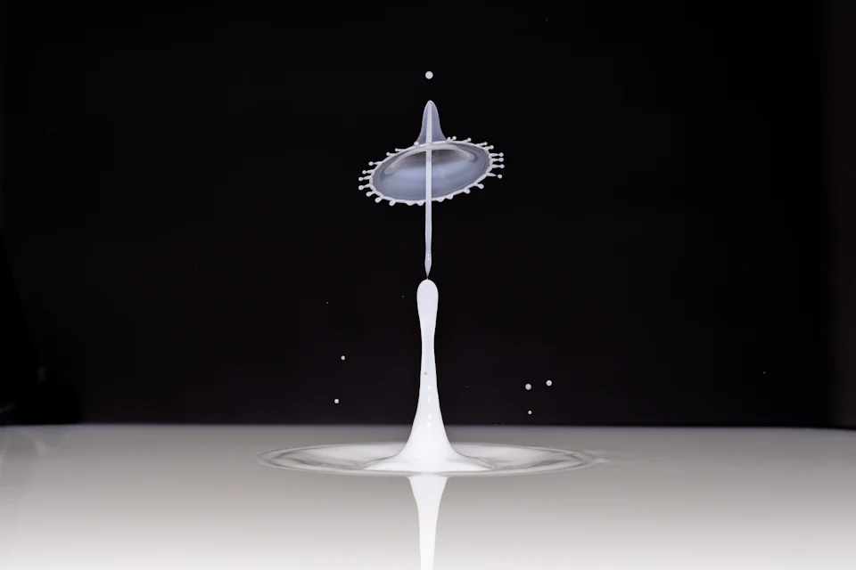
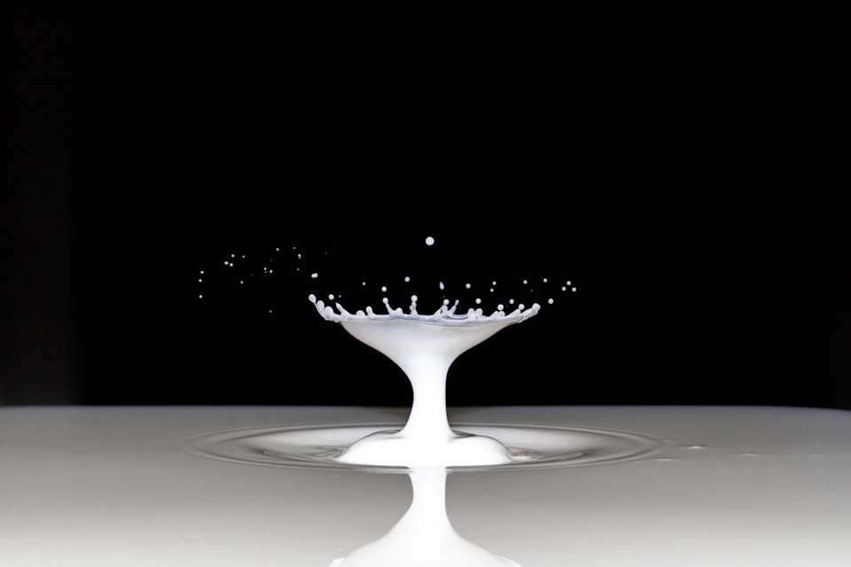
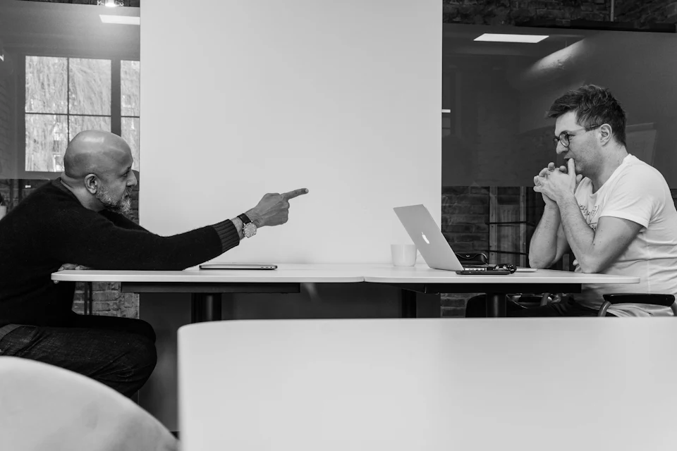
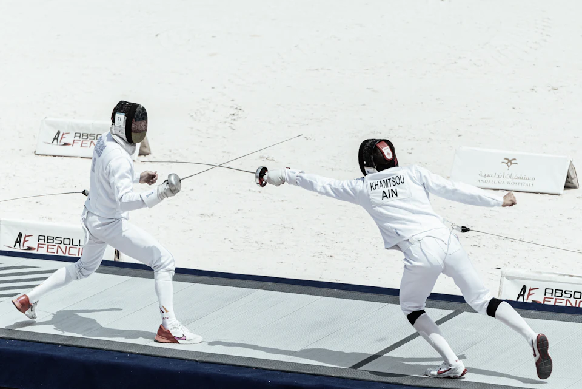
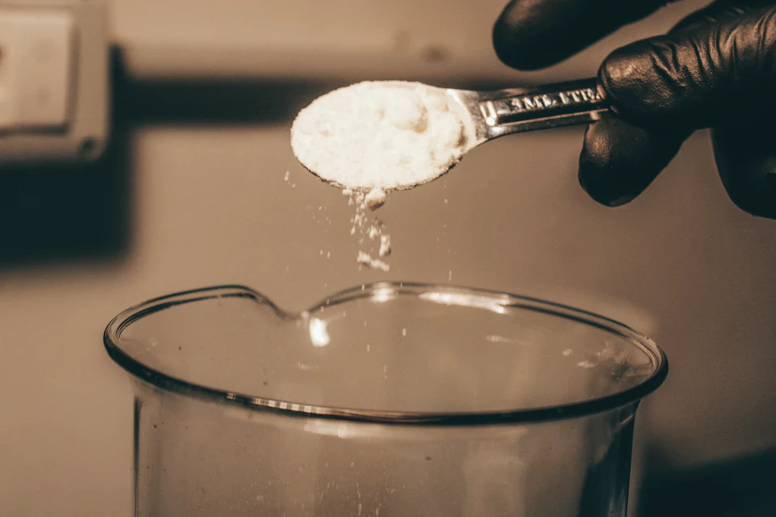
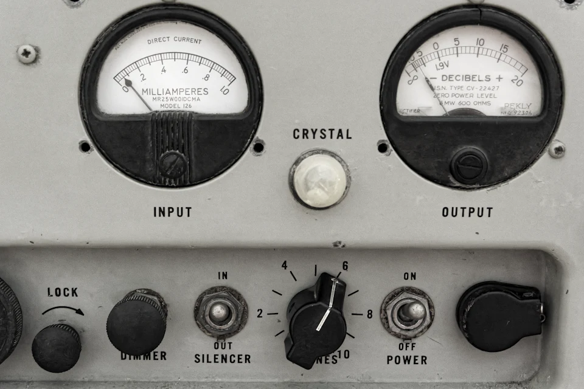

# Math Intellect — Film 04: Photographic Casting Reel & Media Audit
Date: 13 October 2026
Branch: main only
Stage: photographic pre-production. No marketing JSX, CSS or animation implementation in this phase.

## Executive director's assessment

The creative world is now anchored to one genuine family of high-speed liquid-impact photography by Pete Godfrey, with the mathematical protagonist provided by the existing seeded Monte Carlo demo. The splash images are illustrative: they are NOT model output, do not portray a fluid-dynamics engine, and are not claimed to be consecutive exposures of one event.

The visitor experiences an original question, sees its assumptions, studies sampled alternatives, changes one parameter, compares the mathematically computed difference, explores five model categories, and finally returns to the original condition and source photograph.

This is a production casting document, not a declaration that the final website is already built. Images staged in GitHub can still be rejected in the final creative review.

## The real image reel

### Three photographs from one experimental world

| Opening — impact origin | Alternate — aftermath | Alternate — material variation |
|---|---|---|
|  |  |  |
| Pete Godfrey — core protagonist | Pete Godfrey — cause/change montage | Pete Godfrey — branching/replay memory |

Unlike the rejected crossings/railways/rivers concept, these frames are from one identifiable physical experiment photography series. It is an EDITORIAL analogy rather than a simulation of a milk splash.

### The actual five-model photographic casting board

| Engine | Committed image | Directorial judgment |
|---|---|---|
| Monte Carlo |  | Carry same protagonist into the model atlas. Actual 24 deterministic paths remain the mathematical evidence. |
| Game Theory |  | Strong genuine face-to-face visual, readable as two players; favorable pending a full static composition. |
| Market |  | RECAST NEEDED. True financial subject but screen/chart cliché conflicts with the user's principal objection. Staged fallback, NOT approved final hero. |
| Conflict |  | Real opposing action, distinctive bright/white field. Venue signage and busy backdrop mean creative approval is conditional. |
| Custom |  | Real intervention, strong material close-up and restrained warmth. Editorial analogy; photography is originally of perfumery, not Math Intellect. Conditional approval. |

Method page:  — close-up of real historical measurement equipment by Eric Prouzet. This is not Math Intellect instrumentation.

Reserve photograph:  — Green Liu, currently visually disconnected from the other subjects; retain only as reserve rather than inserting it just to add more photography.

## Source provenance — confirmed standard free Unsplash License

Every canonical photo page below lists Download free / Free to use under the Unsplash License, NOT an Unsplash+ exclusive asset. Standard license: https://unsplash.com/license. Attribution should be preserved in the future production media manifest and footer credits even though the standard license does not require it.

| Local source filename | Photographer | Canonical page |
|---|---|---|
| mi-film-impact-origin.jpg, plus 3840-pixel master | Pete Godfrey (@octopus_photo) | https://unsplash.com/photos/milk-splash-frozen-in-time-against-black-background-6ieRRBACAqM |
| mi-film-impact-aftermath.jpg | Pete Godfrey | https://unsplash.com/photos/milk-splash-with-droplets-against-black-background-UAjcZ1qBzE0 |
| mi-film-impact-variation-mono.jpg | Pete Godfrey | https://unsplash.com/photos/water-droplet-collision-creating-a-crown-splash-6nk-Shl0fsw |
| mi-film-game-theory.jpg | Adam Rutkowski (@hq1) | https://unsplash.com/photos/two-men-sitting-at-a-table-with-a-laptop-r_WVQzfgClw |
| mi-film-market-observation.jpg | Jakub Żerdzicki (@jakubzerdzicki) | https://unsplash.com/photos/trader-analyzing-stock-market-charts-on-multiple-screens-j_hho1mE47s |
| mi-film-conflict-fencing.jpg | Omar Abozeid (@omar_abozeid) | https://unsplash.com/photos/two-fencers-in-white-gear-competing-on-a-strip-8ZKU0g-H5xg |
| mi-film-custom-experiment.jpg | Fulvio Ciccolo | https://unsplash.com/photos/a-person-spooning-sugar-into-a-glass-of-water-uFNo0CRqgU4 |
| mi-film-method-measurement.jpg | Eric Prouzet | https://unsplash.com/photos/a-close-up-of-an-old-fashioned-radio-US1ndpdptUI |
| mi-film-human-interaction.jpg | Green Liu | https://unsplash.com/photos/a-group-of-people-standing-next-to-each-other-OwgaIM4e9TY |

The local folder named source contains downloaded JPEG image deliveries with stated transform settings, not the photographer's untouched camera RAW files. No photo in this cast is a real product/customer photo or modeled outcome.

## File inventory: verified in GitHub main

Root: frontend/public/media/math-intellect/cinematic/

- source/: 10 complete JPEG files (9 photographic subject files plus the upgraded 3840px hero master).
- optimized/avif/: 16 responsive size variants.
- optimized/webp/: 16 responsive size variants.
- optimized/mobile/: 4 intentionally cropped portrait assets.
- Total: 46 actual committed binary assets.

Every one of eight principal image stems has BOTH AVIF and WebP in 960px and 1920px widths. The files were obtained as complete CDN derivatives, length checked, and stored as immutable Git blobs before main branch commits. The 3840px master and large Market JPEG were downloaded in independently verified byte ranges to prevent truncated uploads. The one incomplete Method response was rejected and downloaded again, complete.

Current test color reduction applied to derivatives:
- Origin, aftermath and Game Theory: natural source tone.
- Variation: full grayscale.
- Conflict: saturation -65.
- Market: saturation -80.
- Custom: saturation -45.
- Method: saturation -80.

These grades are PROVISIONAL until compared in true hero and gallery compositions. Raw JPEG deliveries are preserved so grading can be adjusted without losing source material.

## Mobile crop test: actual photographic pixels inspected

Portrait test: 320×440, entropy/center crop derived from each source.

| Photograph | What the crop really contains | Decision |
|---|---|---|
| Origin | Full impact column and crown still visible | Provisional ACCEPT. True portrait AVIF/WebP at 960×1280 committed. |
| Game Theory | Only one decision-maker survives | REJECT portrait. Native wide photograph needed so the two-person game remains visible. |
| Conflict | One fencer vanishes from view | REJECT portrait. Native widescreen image must show the actual opposing actors. |
| Market | Hand and screen visible | Usable crop technically; image itself still requires creative recasting. |
| Custom | Crops controlling hand away and makes spoon appear detached | REJECT portrait. Preserve whole hand/spoon/vessel relationship in a wide image. |
| Method | Close view of one dial and actual input control hardware | Provisional ACCEPT. True portrait AVIF/WebP at 960×1280 committed. |

Mobile is NOT desktop's pinned horizontal stage scaled down. Game Theory, Conflict and Custom will use complete landscape photos in vertically edited chapters. Two sequential meaningful detail crops may supplement but never replace the whole interaction. No hidden sideways scrollbars or mobile crop that amputates a participant.

## What each image does in the 14-shot film

Shots 01–03: opening origin master to smaller physical photographic plate, actual assumption registration and seed.

Shots 04–06: genuine Monte Carlo 24-path field, source photo as residue, motion resolves into a readable variance result.

Shots 07–09: user changes only sigma; photograph is an illustrative contrast while exact recalculated paths and differences share a common axis. Never imply the actual splash was caused by Math Intellect.

Shots 10–11: five photographic model panels with large unequal silhouettes, 5–12% next-panel anticipation, different inner-image speed, overlap, readable holds, and accurate route-to-route image ownership.

Shot 12: actual deterministic replay of seed and unchanged input parameters, original image returns as memory.

Shots 13–14: wide/portrait photographic reprise resolves into giant Math Intellect finale with real workbench/signup links and accessible utility.

Reference transfer: Lando Norris for protagonist/data/finale, LIKOVA for transforming one subject into different representations, White Desert for loud/quiet editing, Studio Arde and Fabian Ferdinand Fallend for purposeful horizontal photography. No copied layouts, color systems, loader gating, or unsupported WebGL fallbacks.

## Artistic gates, without pretending completion

GATE A — Source acquisition: COMPLETE for this provisional cast, verified 46 repository files.

GATE B — Quality of the five-model cinema: NOT LOCKED. The Market hero must be recast or prove itself in a convincing composed still; Conflict and Custom remain conditional. Strong subject-matching is not sufficient.

GATE C — Desktop stills: OPEN. Need actual 1440×900 and 1366×768 compositional image/type/crop review; asset presence alone proves nothing about quality.

GATE D — Mobile: PARTIALLY CLOSED. Two valid portrait assets staged and three harmful automatic crops rejected; final mobile route-stage compositions still open.

GATE E — Accessibility and fast/reverse scroll: implementation-stage gate, not possible to sign off from still photography.

GATE F — Homepage production coding: NOT STARTED in Film 04. Do not edit marketing UI until GATE B/C resolve.

The next director's action is art-directed still-frame composition and replacement search for weak Market imagery. Only after image casting passes should full cinematic homepage coding begin.