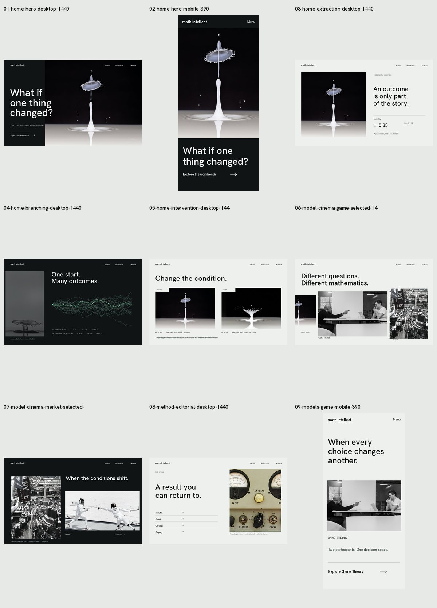
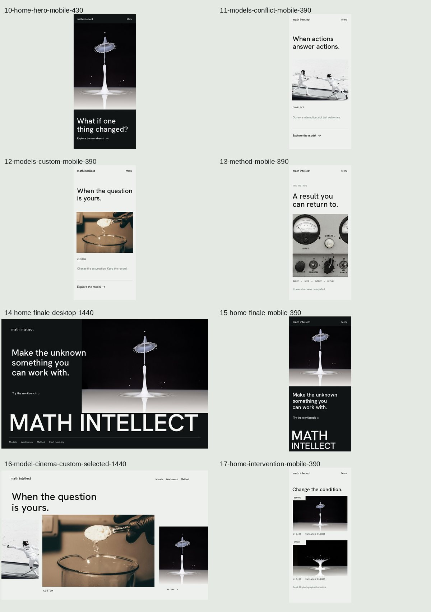
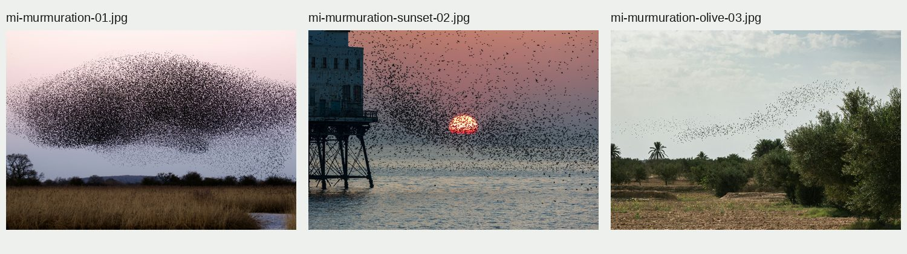
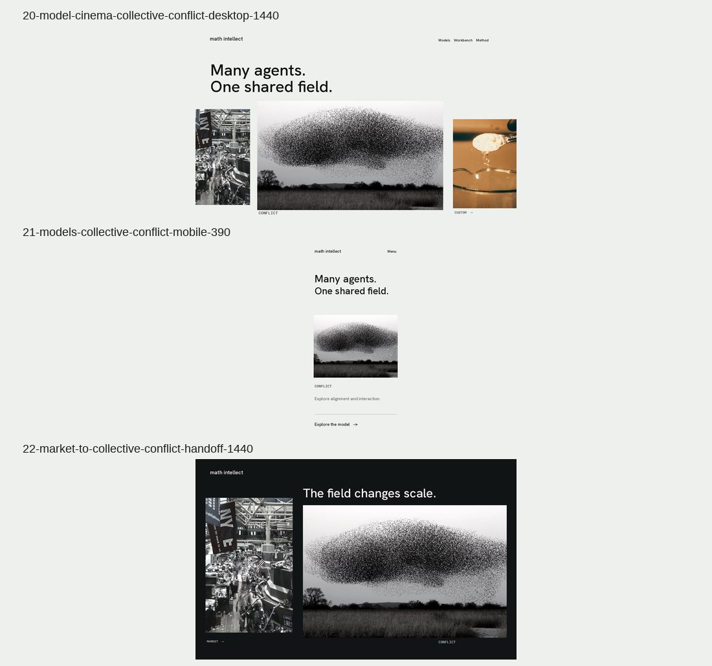

# MATH INTELLECT — FILM 05
## Static-frame director's review, collective-motion recast and storyboard signoff ledger

**Date:** 13 October 2026  
**Working branch:** main only  
**Stage:** Image-based pre-production. No public React components, styling, animation implementation or new marketing routes were changed during Film 05.  
**Authority:** Companions to Film 01 Director's Treatment, Film 02 Choreography, Film 03 Master Script and Film 04 Casting Reel.  
**Decision:** PRE-PRODUCTION STILL TREATMENT PREPARED; CINEMATIC WEBSITE NOT IMPLEMENTED; FINAL 9/10 CREATIVE ACCEPTANCE NOT CLAIMED.

> A convincing static frame is a necessary condition for great animation, not sufficient proof of a final Awwwards-level experience. These are actual offline raster compositions made from real photographs and real product-derived numerical parameters. They are not browser screenshots, they are not live marketing pages, and no photo was generated with AI.

---

# 1. The actual visual reel

**First nine core shots:**  

**Additional mobile, finale and last-model frames:**  

**Conflict casting alternatives: actual source photographs already held in the repository:**  

**Preferred Conflict still and Market → Conflict transition test:**  

### All individually inspectable film frames

| Screen | Real composed still | Film function |
|---|---|---|
| Home, 1440×900 | [01 — First frame](./stills/film05/01-home-hero-desktop-1440.jpg) | The unresolved condition, hero photograph and title |
| Home, 390×844 | [02 — Portrait first frame](./stills/film05/02-home-hero-mobile-390.jpg) | Same subject art-directed for small screens |
| Home, 1440×900 | [03 — Extract the condition](./stills/film05/03-home-extraction-desktop-1440.jpg) | Photo becomes a measurement plate |
| Home, 1440×900 | [04 — Branching field](./stills/film05/04-home-branching-desktop-1440.jpg) | Actual computed Monte Carlo trajectories |
| Home, 1440×900 | [05 — Condition change](./stills/film05/05-home-intervention-desktop-1440.jpg) | Photographic analogy and true computed comparison |
| Model cinema, 1440×900 | [06 — Game Theory foreground](./stills/film05/06-model-cinema-game-selected-1440.jpg) | Select between unequally scaled image actors |
| Model cinema, 1440×900 | [07 — Archival Market foreground](./stills/film05/07-model-cinema-market-selected-1440.jpg) | Historical trading-floor photograph with next-panel anticipation |
| Method, 1440×900 | [08 — Editorial publication](./stills/film05/08-method-editorial-desktop-1440.jpg) | Quiet explanation after cinematic motion |
| Models, 390×844 | [09 — Two-party game theory mobile](./stills/film05/09-models-game-mobile-390.jpg) | Both actors remain visible; no cropped-away participant |
| Home, 430×930 | [10 — Second portrait viewport](./stills/film05/10-home-hero-mobile-430.jpg) | Distinct viewport validation |
| Models, 390×844 | [11 — Rejected fencing option](./stills/film05/11-models-conflict-mobile-390.jpg) | Documented former casting, not approved |
| Models, 390×844 | [12 — Custom conditions](./stills/film05/12-models-custom-mobile-390.jpg) | Human-controlled intervention, provisional |
| Method, 390×844 | [13 — Method portrait](./stills/film05/13-method-mobile-390.jpg) | Accessible mobile documentary pace |
| Home, 1440×900 | [14 — Monumental finale](./stills/film05/14-home-finale-desktop-1440.jpg) | The protagonist returns before the brand wordmark |
| Home, 390×844 | [15 — Two-line mobile finale](./stills/film05/15-home-finale-mobile-390.jpg) | Giant name remains recognizable |
| Model cinema, 1440×900 | [16 — Custom foreground](./stills/film05/16-model-cinema-custom-selected-1440.jpg) | Frame-to-frame lateral travel nearing replay |
| Home, 390×844 | [17 — Before/after mobile](./stills/film05/17-home-intervention-mobile-390.jpg) | Two vertically stacked photographic analogies and honest variance |
| Recast cinema, 1440×900 | [20 — Collective Conflict foreground](./stills/film05/20-model-cinema-collective-conflict-desktop-1440.jpg) | Strong preferred group-interaction photograph |
| Recast Models, 390×844 | [21 — Collective Conflict mobile](./stills/film05/21-models-collective-conflict-mobile-390.jpg) | Flock remains complete |
| Transitional still, 1440×900 | [22 — Market to collective motion](./stills/film05/22-market-to-collective-conflict-handoff-1440.jpg) | Two visual worlds overlap, with a clear subject change |

**Totals:** 20 authored scene-composition stills + 4 contact/source-comparison boards = 24 JPG files in this review folder. The older film documents and pre-production JSON casting manifest continue to carry photo provenance and proposed behavior.

---

# 2. DIRECTORIAL REVIEW — WHAT ACTUALLY WORKS

### The home hero now has an identifiable photographic protagonist
Pete Godfrey's stark high-speed liquid-impact photograph occupies a deliberately staged environment, with typographic negative space, instead of loosely relevant road/rail/river photos. The 390×844 and 430×930 tests preserve the main physical column and its crown without crushing the CTA.

**Qualified:** its fluid subject is an editorial metaphor, not evidence that the product calculates fluid dynamics. The following scene must make the model's mathematical identity clear immediately. The first desktop still's hard black photo-panel boundary is a visual weakness to refine, not a style decision to freeze.

### Photo-to-model continuity now has an actual image-to-image plan
Shot 03 reuses the opening source as a cropped investigation plate; Shot 04 transitions to actual computed paths and retains a photographic residue. This is more truthful and more coherent than nine separate "Movement" graphics.

**Qualified:** static mockups do not demonstrate that the same physical crop truly travels from one DOM rect to the next or that reverse scrolling reconstructs it. Those remain implementation/visual QA requirements.

### The numerical visual is grounded in repository code
The relevant source is frontend/src/math/deterministicModels.ts. Its seeded Monte Carlo simulation uses mulberry32 with bitwise integer hashing, Box-Muller Gaussian sampling, 50 time steps and 24 trajectories.

For the visible preproduction test:
- mu = 0.05
- baseline sigma = 0.35
- changed sigma = 0.60
- seed = 42
- steps = 50
- paths = 24

**Verified against an independent JavaScript reproduction of the actual source algorithm:**
- Baseline sample mean: -0.03764629855502894
- Baseline sample variance: 0.08059278520562206
- Changed sample mean: -0.10025079752290678
- Changed sample variance: 0.2368441034614198

The FIRST offline trace draft had a bitwise PRNG translation error; it was corrected BEFORE the stills were committed. The values above and the final branching/comparison frames are derived from the corrected, exactly matching algorithm. They are **sample outcomes in this demo**, not a statistical theorem that variance always increases for every particular sample when sigma changes.

### Horizontal image cinema begins to have meaningful compositions
Two authored progress states emphasize the complete two-player Game Theory photograph, tall archival Market field, and meaningful image overlap. The Custom model has its own state rather than an equal-size tile. Image selection is useful only if it leads to real model detail; future keyboard and mobile navigation cannot depend on a visual-only custom cursor.

**Qualified:** market floor is historic and visually dense. The source is by Carol M. Highsmith from between 1980 and 2006, not current market data. No real trading-venue footage is a screenshot of Math Intellect output. The archival original has limited resolution compared with the 3840px hero and should remain a tall editorial actor, never a forced ultra-wide full-screen 4K texture.

### The big footer finally has a designed still
The finishing shot reprises the original photo and yields to an oversized MATH INTELLECT wordmark, with desktop and mobile authored separately. A first desktop still incorrectly allowed the wordmark to overlap the footer utility line; that collision was detected and corrected before the image was uploaded.

**Qualified:** earlier production footer JSX does not yet implement this photo handoff. A composed still is an art direction contract, not a deployed result.

---

# 3. MAIN RECAST: Conflict is a 32-agent field, not two fencers

The existing public model helper runConflictInteraction(radius=0.4, coupling=0.5, numAgents=32, seed=77) initializes 32 agents with positions and velocity vectors, then derives coherence and cluster count. The two-fencer photo suggests a different mental model: a single direct duel between two actors. It was visually energetic but conceptually reductive.

**Better editorial world:** a dramatic real starling murmuration, where large-scale group movement and directional coordination are visually intelligible. This is still illustration — not the generated 32-agent model. It is, however, significantly closer to the actual mathematical questions of alignment, agents and interaction.

Three previously licensed/source-backed photos already exist on main:
- mi-murmuration-01.jpg — James Wainscoat, source ref MI-PH-005.
- mi-murmuration-sunset-02.jpg — Pete Godfrey, MI-PH-006.
- mi-murmuration-olive-03.jpg — Mohamed Fsili, MI-PH-007.

They were re-inspected from their actual repository image bytes. The first, a dense dark formation against a restrained landscape, is the **preferred Conflict candidate**. It is already available at frontend/public/media/math-intellect/source/mi-murmuration-01.jpg with 768/1280/1920/2560 AVIF/WebP derivatives in the existing source manifest, so we deliberately do not duplicate several megabytes of source photography into the new cinematic folder.

The [new desktop](./stills/film05/20-model-cinema-collective-conflict-desktop-1440.jpg), [mobile](./stills/film05/21-models-collective-conflict-mobile-390.jpg), and [Market-to-Conflict transition](./stills/film05/22-market-to-collective-conflict-handoff-1440.jpg) are meaningful improvements. The prior fencers remain documented in the film reel only as a rejected prototype. The pre-production JSON casting manifest is updated accordingly with CIN-11 as the preferred existing-asset candidate.

**New suggested copy:** "Many agents. One shared field." Avoid "When actions answer actions," which suggests only two opposing players and makes the Conflict route redundant with Game Theory.

---

# 4. MOBILE IS A SEPARATE EDIT, NOT A SHRUNK DESKTOP

The actual portrait/landscape tests establish distinct rules:
1. Home 390 and 430: maintain impact crown, column and lower-wordmark composition; CTA must fit without movement.
2. Game Theory: preserve BOTH human actors via wide native source, not an auto-cropped 3:4 photo where one disappears.
3. Conflict: the collective formation has a photographic silhouette; hold it in an intentionally wide editorial crop. The old two-fencer still is rejected regardless of its technically successful compression.
4. Custom: preserve complete hand, spoon and vessel. The portrait crop removing the hand was rejected.
5. Method: a deliberate instrumentation close-up with a separately readable provenance/explanation, not an actual Math Intellect meter.
6. Before/after: stack two legible full-width visual states with actual source-derived values; no 45vw side-by-side thumbnails.
7. Finale: giant two-line MATH / INTELLECT remains readable with useful CTA rather than clipping at 390px.

The real mobile animation should be edited in vertical-flow sequences, not force the desktop horizontal gallery or a nested scrollbar.

---

# 5. A CRITICAL REVIEW: WHY THIS IS STILL NOT ACCEPTED AS 9/10

**A. Hero visual seam.** The hard line between left pure-black title field and source image makes the first still feel like a sophisticated split landing page rather than a seamless film frame. The framing should evolve into one contiguous photographic stage while keeping typographic contrast.

**B. Controlled source world, but repetitive object.** The impact shot is strong, yet repeated too often it risks looking like one good stock photograph reused across the entire experience. It must meaningfully transform between source, trace, evidence and finale; different crops alone may be insufficient.

**C. Product-perception risk.** The liquid experiment is an evocative metaphor but could imply a fluid-dynamics product. The next frame must clarify the stochastic decision/simulation workbench quickly and accurately without a paragraph explaining the image.

**D. Custom casting quality.** The warm spoon-and-glass experiment is clear but close to ordinary product/perfumery stock. This remains a replacement candidate unless a larger 1440px composed frame makes it genuinely distinctive.

**E. Market/archive juxtaposition.** Archival NYSE imagery is markedly better than screens of stock charts, but the handoff to the modern visual world must feel intentional: photography as a real system observed at different scale, not a random period photo.

**F. Typographic individuality.** Hanken Grotesk was used to RASTERIZE temporary typography into these JPG stills. No font binaries are committed or shipped by these stills. The family and weights are candidates, not the final selected face. More sophisticated rhythm, optical alignment and size contrast are still possible.

**G. Still is not moving image.** These boards do not verify Lenis smoothness, image-plane parallax, horizontal gallery speed/measurement, route FLIP, lazy loading, scroll reversibility, keyboard focus, reduced motion or animation teardown. Those are intentionally left for implementation/live-browser QA rather than certified from Photoshop-like boards.

**H. Insufficient browser review.** Static contact sheets are actual image pixels but not screenshots from production. They can validate composition proposals only, not live viewport output or performance.

No independent design award, 9/10 score or production acceptance has been obtained.

---

# 6. PHOTO RIGHTS AND CLAIM DISCIPLINE

- Unsplash images remain linked to individual canonical pages and authors in casting-manifest.preproduction.json and the original marketing mediaManifest.ts. Standard Unsplash free license must be distinguished from Unsplash+ exclusives, which were not downloaded through an authenticated Plus entitlement.
- Carol M. Highsmith's 2011630168 Library of Congress image says "No known restrictions on publication." LOC also warns that third-party rights and jurisdictional clearance remain the publisher's responsibility. The source's 1980–2006 attribution must stay accurate.
- No image depicts the user, Math Intellect customers, real Math Intellect UI output, a fluid simulation from this product, or current NYSE market conditions unless there is independent evidence.
- Raster compositions use actual staged photographs with changed crops/limited monochrome grading; no synthetic replacement photography or fabricated metrics.
- The actual linked files in docs/ui-ux/stills/film05 are preproduction artifacts only. The main live marketing UI is unchanged by this film.

---

# 7. FILM 06 HANDOFF: PRODUCTION ENTRY GATES

| Gate | Status | Remaining obligation |
|---|---|---|
| Core film premise and shot-by-shot timeline | COMPLETE | Preserve physical-to-computational continuity |
| Source acquisition for primary subjects | COMPLETE / conditional casting | 11 cinematic source JPEGs and 36 optimized derivatives; reused MI-PH-005 source |
| Real stills | COMPLETED AS PREPRODUCTION SET | 20 actual composed states with four audit contact sheets |
| Market recast | PREFERRED | Archival image; final spatial/crop QA and historic label |
| Conflict recast | PREFERRED | Murmuration better matches multi-agent alignment; needs final art-direction signoff |
| Custom photography | OPEN | Evaluate stronger, darker controlled-intervention imagery |
| Font/type direction | OPEN | Choose a truly distinctive licensed typographic system and final width/weight design |
| Hero compositional seam | OPEN | Refine beyond split-panel appearance |
| Production route transitions | NOT IMPLEMENTED | Pre-nav capture → real target image measurement → ownership handoff |
| Home and secondary routes | NOT IMPLEMENTED | Work on main only after image lock |
| Live desktop/mobile QA | NOT DONE | Manual visual, keyboard, reduced motion, fast/reverse scroll; no Playwright |

**Decision:** Film 05 achieves the concrete preproduction step that was missing: real photographed, actually composed desktop/mobile stills; a mathematically corrected source-to-path scene; a documented image-casting correction derived from the engine itself; and two auditable contact reels. It does not yet justify starting the full frontend rebuild without resolving the outstanding hero and Custom art direction concerns.

**Next responsible step:** final photo and typography art direction refinement; only then implement the Home film as one directed sequence, not multiple independent marketing sections.
