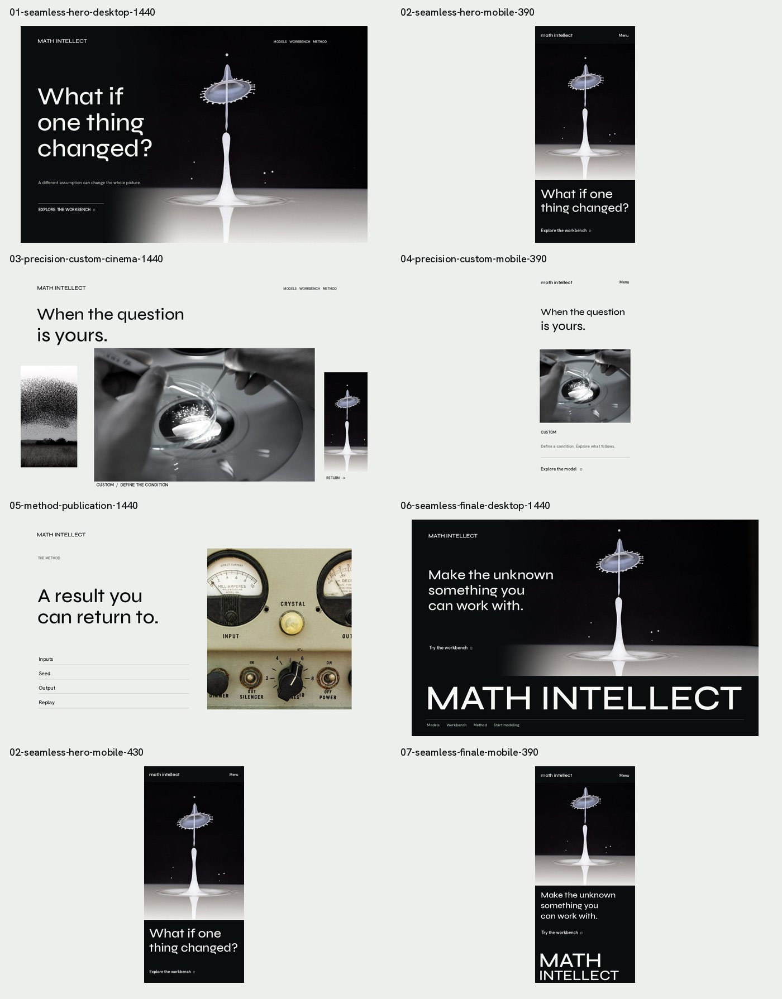

# MATH INTELLECT — FILM 06
## Director's image-and-type decision, source casting revision and static-frame handoff
**Date:** 13 October 2026  
**Branch:** main only  
**Phase:** pre-production art direction, image procurement, typographic exploration and raster viewport stills  
**Production coding:** NOT undertaken in this phase. No new marketing routes or dashboard changes.  
**Relationship:** extends Film 01–05; supersedes their Custom preferred photography and first hero split-panel composition where incompatible.

## 0. Decision: a director's cut, not another landing page

The film follows ONE product-native numerical scenario: an unresolved question → an explicit condition → many seeded possibilities → a visitor changes exactly one condition → baseline and intervention are compared → five real model families broaden the story → the original condition is reproducibly returned to → MATH INTELLECT closes the experience.

The photographic protagonist consists of **real high-speed liquid impact stills**, which are an editorial analogy ONLY. The quantitative proof remains the actual deterministic Monte Carlo helper already in the source. No photo has been fabricated, no picture represents an actual Math Intellect user or model output, and the liquid experiment does not mean the product runs fluid-dynamics physics. Image, data, typography, and actual user controls own distinct roles in the film.

Film 05 left three outstanding compositional issues:
1. The black-to-photograph hero seam made a potentially striking film frame look like a split landing page.
2. The warm spoon/glass Custom scene felt generic and materially disconnected from the cool precision/collective-motion visual world.
3. Hanken Grotesk was a tasteful but insufficiently distinctive sole display voice; the giant footer and Method reading mode needed a cross-route typographic contract.

These three issues received actual pixel-level A/B tests, not a replacement paragraph of aspirational prose.

---

## 1. Actual images produced — 9 committed raster files

### Combined director's reel

All frames are authored desktop/mobile preproduction stills. They are NOT screenshots of deployed frontend routes and contain no working interactions.

| Shot | Actual committed still | What it verifies |
|---|---|---|
| Home / 1440×900 | [Seamless photographic opening](./stills/film06/01-seamless-hero-desktop-1440.jpg) | Physical source and typographic negative space read as one environment, not two joined rectangles |
| Home / 390×844 | [Mobile portrait hero](./stills/film06/02-seamless-hero-mobile-390.jpg) | Crown/column retained, readable title and real workbench CTA at first frame |
| Home / 430×930 | [Wider mobile portrait hero](./stills/film06/02-seamless-hero-mobile-430.jpg) | Different line length, tested right-edge bounding box instead of an assumed text clamp |
| Home→Models / 1440×900 | [Custom photographic cinema](./stills/film06/03-precision-custom-cinema-1440.jpg) | Prevailing collective motion, incoming real human precision action, later return to original protagonist |
| Models / 390×844 | [Custom mobile alternative](./stills/film06/04-precision-custom-mobile-390.jpg) | BOTH hands and the object remain visible in a natural wide image, no crop amputates causality |
| Method / 1440×900 | [Technical editorial spread](./stills/film06/05-method-publication-1440.jpg) | Display voice complements quiet body text and documentary-style instrument photograph |
| Home finale / 1440×900 | [Photo-to-wordmark ending](./stills/film06/06-seamless-finale-desktop-1440.jpg) | Source returns and gives way to a huge brand wordmark without utilities colliding with letters |
| Home finale / 390×844 | [Mobile wordmark ending](./stills/film06/07-seamless-finale-mobile-390.jpg) | Two-line MATH / INTELLECT remains legible within phone width |

**Image QA:** Each authored JPEG was generated from committed actual licensed/source-backed photography, inspected via contact reel, tested for right-side type boundaries at 390px/430px, uploaded as a verified complete binary Git blob and committed on main. These tests validate *proposed compositions*, not live DOM accessibility or 9/10 visual acceptance.

---

## 2. Camera / editing decision — the hero seam is rejected

**Previous:** hard vertical division between pure black narrative copy and a separately boxed impact photo.

**Now:** the actual Pete Godfrey frame occupies most of a wide photographic stage. A narrow masked left-edge matte blends real black photographic negative space into the dark stage. The text lives *inside the perceived environment* rather than on an adjacent rectangular UI panel.

The mask is a media-edge treatment, NOT a neon interface gradient or fake synthesized photograph. Source materials remain unaltered in /source. The physical column and crown preserve their meaningful location from opening to ending; mobile is a separate portrait edit with the hero CTA visible at first viewport.

**Mechanical transition specification for coding later:**
- Cold open: immediate photograph, legible type, no 4-second loading gate.
- Camera creep: overscanned photo body shifts subtly while fixed black negative space keeps headline legible.
- Extraction: hero physical image contracts to the evidence plate, retains center/crown registration, shows *real* \`σ\` and seed parameters. No fade-to-another-stock-photo cut.
- Branch: photo compresses to a narrow memory, **actual seeded paths** enter from the real common source point, not random lines.
- Re-entry/finale: same physical world returns at a more resolved framing; giant wordmark claims the final plane. Responsive version edits the layout instead of scaling desktop pinned choreography.

**Still-open:** test real overlapping DOM image elements and GSAP reverse scroll in-browser, verify image contrast across the complete hero area at 1366×768/1440×900, optimize 2560/3200 next-source AVIF/WebP if actual image quality/device DPR justify them.

---

## 3. The Custom recast — a photographic choice justified by the image itself

### Old candidate: retired as principal image
Source: Fulvio Ciccolo, warm spoon-and-glass ingredient addition. Source kept as archived asset; marketing casting manifest CIN-07 changed to \`retired-after-compositional-review\`. Real controllable intervention existed, but in adjacent frames the warm kitchen/perfumery world resembled generic product stock.

### New preferred candidate: precise intervention
**Photographer / source:** National Cancer Institute (@nci), [Hands using tweezers with petri dish](https://unsplash.com/photos/hands-using-tweezers-with-petri-dish-OYlhHhzksuk). The canonical page lists "Free to use under the Unsplash License."  
**Original downloaded derivative in repository:** \`frontend/public/media/math-intellect/cinematic/source/mi-film-custom-precision-nci.jpg\`  
**Actual delivery:** image-URL-derived JPEG, 2800×1824, 497,726 bytes. NOT camera RAW and NOT a Math Intellect photo.  
**Responsive assets already staged locally:**
- \`optimized/avif/mi-film-custom-precision-nci-960.avif\`
- \`optimized/avif/mi-film-custom-precision-nci-1920.avif\`
- \`optimized/webp/mi-film-custom-precision-nci-960.webp\`
- \`optimized/webp/mi-film-custom-precision-nci-1920.webp\`

All four transcodes were validated by exact decoded byte lengths and corresponding AVIF/WebP binary signatures before being committed. Tests use a muted photographic grade; source is retained. The chosen scene clearly shows TWO hands, precision tweezers and a material specimen. This is an editorial metaphor for defining/adjusting a condition — no implication that the software performs microscopy or is used by the photographed people.

**Casting status:** \`preferred-photo-preproduction-not-production-locked\` (CIN-12 in \`casting-manifest.preproduction.json\`). It materially improves the visual field but needs a final large-viewport art-director signoff when presented with all five selected model images at once.

**Mobile rule:** use a 354px-wide but physically WIDE full-action photograph in a vertically edited Models scene. Reject any portrait crop that cuts off one of the acting hands. No desktop horizontal scroll trap on touchscreens.

**Incoming film grammar:** wide collective starling photo (genuine large-agent analogy, MI-PH-005) → overlap/anticipate incoming precision hands → custom condition caption and actual model link → narrow return image acting as a photographic memory of the film's origin. At rest the subject is readable. During travel the outer frame and inner crop can counter-parallax with one motion owner; do not animate unrelated CSS transforms on the same layer.

---

## 4. Typography decision — after calibrated cross-route tests

Actual display candidates compared with variable weight controls correctly set:
- Hanken Grotesk: excellent restrained interface/reading voice but too anonymous as the *only* cinematic display font.
- Bricolage Grotesque: lively optical/width/weight axes but too informal/dense in the restrained product Method and giant wordmark context.
- **Syne:** stronger spatial letterforms, precise editorial personality, enough clarity in film opening, quiet Method spread and huge closing identity when set around variable 480–560 weights.

**Preferred working family split for Math Intellect marketing:**
- **Syne variable** — short cinematic display phrases and large finale wordmark, not every label, around 450–560 depending scale.
- **Hanken Grotesk variable** — navigation, CTA, body, method details and compact product explanation.
- **IBM Plex Mono** — explicit mathematical metadata, seed/sample counts and tabular values only.
- Existing valid KaTeX math glyphs retained for formulas; mono text is not a replacement for actual math typesetting.

The Syne and Hanken families are freely available under SIL Open Font License 1.1 through Google Fonts. References: https://github.com/google/fonts/tree/main/ofl/syne and https://github.com/google/fonts/tree/main/ofl/hankengrotesk . **No font binaries have been committed or distributed during this image-first phase.** Website webfont setup, subsetting, optical size and fallback metrics remain future coding tasks. The typography choice is a **directional lock for Film 06 stills**, not an assertion that actual browser kerning/font loading has passed.

**Hero copy:** "What if one thing changed?"  
**Supporting line:** "A different assumption can change the whole picture."  
**Custom chapter:** "When the question is yours."  
**Method:** "A result you can return to."  
**Finale:** "Make the unknown something you can work with."  
Copy is a compact editorial system. None implies predictive certainty or a magical AI model.

---

## 5. Product truth cannot be traded for spectacle

The physical experiments, archival trading floor, human conversation, actual collective starling movements, and measurement equipment are photographic editorial illustrations. The computation remains in real Math Intellect routines.

Current public Monte Carlo seed demonstration uses baseline \`μ=0.05, σ=0.35, steps=50, paths=24, seed=42\`. When showing changed volatility in the story, compute real outcomes from the SAME generator and preserve other inputs. Correct sample variance values for baseline and \`σ=0.60\`, independently reproduced from JavaScript in Film 05, are about \`0.080592785\` and \`0.236844103\` respectively. Do not insert these as dummy decorative text.

Game Theory is an actual two-player zero-sum calculation in the public helper; the face-to-face photo depicts a genuine two-person decision *analogy*. Conflict's public helper is a seeded 32-agent interaction field; flock imagery is more semantically accurate than the retired two-fencer photo. Market's preferred photographic actor is a Carol M. Highsmith historical NYSE image from the Library of Congress; do not imply a current trading floor or live ticker. The public Workbench is a simplified deterministic demonstration, not the authenticated full simulation engine.

---

## 6. Photo / typography / media release status

| Gate | Status | Basis / concern |
|---|---|---|
| Continuous protagonist, five chapters and actual 14-shot script | Established | Film 01–03 |
| Four marketing route narrative identities | Established | Home film, Models atlas, Workbench instrument, Method publication |
| Hero hard-seam removal | VISUAL STILL CORRECTED | 1440×900 raster; dynamic/moving version not implemented |
| Syne/Hanken/Plex division | PREPRODUCTION CHOICE | Three-family test plus Method/footer A/B |
| Custom recast | PHOTO SECURED, PREFERRED | NCI standard free-license page, JPEG + 4 optimized derivatives |
| Conflicts with two-fencer truth | RESOLVED AT CAST LEVEL | Existing collective image from MI-PH-005 preferred |
| Archival Market image | CAST, LEGAL/FRAME WARNINGS RETAINED | Limited resolution and proper historical labeling |
| Mobile protagonist and model wide images | PARTIALLY VISUALLY REVIEWED | 390/430 hero and 390 Custom; no live device/browser QA |
| Giant footer | STILL REFINED | Wordmark and utility bounds tested in raster only |
| Media audit | SOURCE FILES VERIFIED | New local JPEG/AVIF/WebP; no remote hotlink dependence in future JSX |
| 9/10 finished site | NOT VERIFIED / NOT CLAIMED | All new film scenes and route transitions await coding |
| Motion, scroll, FLIP, interactivity, visual accessibility | NOT BUILT/TESTED | Don't mistake scene still for working interaction |

**No UI/source-code implementation was undertaken in Film 06. The live site remains the old composition plus the prior footer revision.**

---

## 7. Exact next gate, in order

1. View Film 05 and Film 06 contact sheets as one whole editorial campaign, with adjacent source images at hero/model/native mobile crops. Reject anything that reads as a generic stock gallery.
2. Resolve any remaining weakest cast (especially Custom/Market quality in a complete five-model horizontal sequence) and archive rejected alternatives rather than installing them.
3. Accept desktop and mobile static compositions, not only the image subjects.
4. Map motion beat by beat from Film 02 to actual layers in the existing React/GSAP/Lenis system, with a real user-controlled seeded parameter. Establish temporal continuity and reverse-scroll behavior.
5. **Only then** start production implementation directly on \`main\`, first rebuilding the continuous Home film, followed by Models / Workbench / Method and real route-to-route image continuity.
6. QA through actual browser/mobile/reduced-motion/keyboard checks and real Vercel output. A Vercel READY documentation deployment alone proves none of these.

**Director's decision:** We have improved the source cast, corrected two composition failures and selected a coherent typographic direction. We have NOT certified the final website, guaranteed an Awwwards score, or authorized an unfinished animated landing page to replace production.
